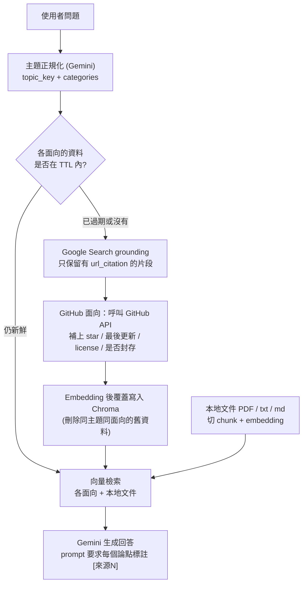

# RAG QA Agent — 會自己判斷資料新不新的知識庫問答

結合**本地文件**與**網路搜尋**的 RAG 問答工具。提問時先判斷主題與想查的面向（新聞 / 論文 / GitHub 工具），知識庫裡該主題的資料若已過期就重新搜尋並覆蓋，再根據檢索到的內容產生附來源引用的回答。提供 CLI 與 Gradio 網頁介面。手刻 RAG pipeline（不使用 LangChain），向量資料庫為 Chroma，LLM 與 embedding 使用 Google Gemini API。

## 流程



## 設計重點

- **新鮮度管理**：每筆網路資料都記錄 `topic_key`、`category`、`fetched_at`。提問時逐面向檢查最新的 `fetched_at`，超過 TTL（預設 24 小時，可用 `FRESHNESS_TTL_HOURS` 調整）才重新搜尋；重新搜尋時先刪除同主題同面向的舊資料再寫入，知識庫不會累積過期內容。
- **降低幻覺**：
  - 搜尋結果只收錄模型輸出中有 `url_citation` 標註的文字片段，沒有來源佐證的句子不進知識庫。
  - 生成階段的 prompt 限制只能根據檢索內容作答、每個論點標註來源，資料不足時直接回答查無資料；沒有檢索結果時不呼叫模型。
- **GitHub 工具不背書**：prompt 限制模型只能陳述 GitHub API 取得的客觀數據，不得宣稱工具「安全」；回答包含 GitHub 來源時，程式會固定附上「未經資安審查」的提醒。
- **只做資訊呈現**：不會自動下載、clone、安裝或執行任何搜尋到的程式碼或工具，只提供文字內容與來源連結，是否採用由使用者自行判斷。
- **容錯降級**：主題分類回傳的不是合法 JSON 時，退回「三個面向都查」；GitHub API 失敗時略過該筆的指標，不中斷流程。
- **可測試**：Gemini client 與 Chroma collection 都能以參數注入；測試使用記憶體內的 Chroma，並以 mock 取代 Gemini 與 embedding 呼叫，不需要 API key 或網路。

## 模組

| 模組 | 職責 |
|---|---|
| `topic.py` | 問題 → `{topic_key, categories}` |
| `web_search.py` | 依面向呼叫 Google Search grounding，抽出有引用的片段 |
| `github_meta.py` | 取得 repo 的 star、最後更新、license、是否封存 |
| `ingest.py` | 本地文件匯入；網路結果的覆蓋寫入 |
| `chunking.py` | 固定長度 + overlap 切分（500 / 50，僅用於本地文件） |
| `embeddings.py` | Gemini embedding（查詢與文件使用不同 task type） |
| `retriever.py` | Chroma 向量檢索（預設 top-5）、依面向過濾、查詢最新 `fetched_at` |
| `generator.py` | 組 prompt、生成回答、整理來源清單 |
| `agent.py` | 整體流程編排 |
| `config.py` | 環境變數與預設值（模型名稱、TTL、chunk 與檢索參數） |
| `cli.py` / `ui.py` | 命令列與 Gradio 介面 |

## 安裝與使用

需要 Python 3.12+。

```powershell
python -m venv .venv
.venv\Scripts\Activate.ps1
pip install -e ".[dev]"
Copy-Item .env.example .env      # 填入 GEMINI_API_KEY
```

專案也附有 `uv.lock`，使用 [uv](https://docs.astral.sh/uv/) 的話可改用 `uv sync`，指令前加 `uv run`。

環境變數（見 `.env.example`）：

| 變數 | 必填 | 說明 |
|---|---|---|
| `GEMINI_API_KEY` | 是 | 到 [Google AI Studio](https://aistudio.google.com/apikey) 取得 |
| `GITHUB_TOKEN` | 否 | 提高 GitHub API rate limit（未認證每小時 60 次） |
| `FRESHNESS_TTL_HOURS` | 否 | 網路來源視為新鮮的時數，預設 `24` |

```powershell
rag-qa ingest .\data\raw                         # 匯入本地文件 (pdf / txt / md)
rag-qa ask "最近有哪些 RAG 評估工具?"              # 需要時自動重新搜尋
rag-qa ask "最近有哪些 RAG 評估工具?" --refresh    # 強制重新搜尋，不管 TTL
rag-qa refresh "RAG evaluation" --category paper  # 手動刷新單一面向（不指定則三個面向都刷新）
rag-qa-ui                                        # 啟動 Gradio 介面

python -m pytest                                 # 離線測試
```

Gradio 介面預設網址為 `http://127.0.0.1:7860`，分三個分頁：**問答**（與 `rag-qa ask` 同一套邏輯）、**匯入本地文件**（與 `rag-qa ingest` 同一套邏輯）、**手動刷新**（與 `rag-qa refresh` 同一套邏輯）。

## 文件

- [spec.md](spec.md)：規格與設計規則
- `docs/`：各模組的技術文件（演算法、複雜度、依賴關係）

## Future work

- **每日定時自動掃描**：目前只有被動觸發（提問時才判斷要不要搜尋）與手動 `refresh`，若要每天自動追蹤主題需另外接排程機制。
- **GraphRAG**：若需要跨文件、跨主題的關聯查詢可再評估；目前索引階段需要大量額外 LLM 呼叫，暫不採用。

## Tech stack

Python、Gemini API（`google-genai` Interactions API、Google Search grounding、`gemini-embedding-001`）、ChromaDB、Gradio、pypdf、GitHub REST API、pytest

本專案使用 AI 程式助理協作開發。
